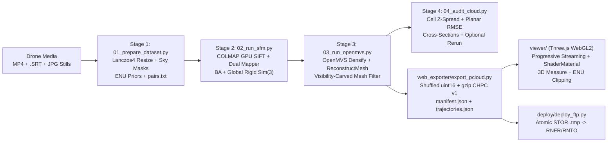

# drone-pointcloud-web3d

**Turn consumer DJI drone videos & photos into clean, metric 3D point clouds (COLMAP + OpenMVS) with a zero-install Three.js WebGL2 viewer.**

[](LICENSE)
[](requirements.txt)
[](viewer/index.html)

---

## Overview

End-to-end open-source pipeline that converts uncalibrated consumer drone footage (MP4 + `.SRT` telemetry + optional EXIF-tagged JPEG stills) into:

1. **Metric East-North-Up (ENU) sparse & dense reconstructions** calibrated via a single global rigid `Sim(3)` alignment (zero per-keyframe warping, eliminating double roofs and wall splits across multi-flight captures).
2. **Delaunay visibility-carved clean point clouds & vertex-colored meshes** via COLMAP + OpenMVS + Open3D `RaycastingScene` surface proximity filtering.
3. **Progressive `.pcloud` (`CHPC` v1) binary streams** (~9 bytes/point raw quantized, ~8.9 MB per 1M points gzipped) served directly to a **zero-install Three.js WebGL2 viewer** with WordPress `?embed=1` support, dynamic ENU X/Y/Z clipping, GPS flight paths, POI pins, and interactive 3D point-to-point distance measurement.

---

## Architecture



---

## Quantitative Benchmark ("Stone Farmhouse & Wooded Hillside" Dataset)

Evaluated on a multi-flight consumer drone dataset combining a 300° architectural orbit, a multi-hectare hillside departure/return loop, and sharp still frames (191 images @ 2048×1152):

| Method | Roof Plane RMSE (cm) | Roof p90 Error (cm) | Open-Cell 0.5m Med Z-Span (m) | Open Cells > 0.5m Spread (%) | Main Footprint Coverage (%) |
|---|---:|---:|---:|---:|---:|
| **MASt3R-SLAM Baseline** *(uncalibrated)* | 21.37 | 36.63 | 0.97 | 90.71% | 59.6% |
| **Refined MASt3R** *(COLMAP + calib)* | 21.19 | 34.78 | 0.73 | 68.29% | 100.0% |
| **Depth Anything 3 (DA3)** *(pose-cond.)* | 32.08 | 55.73 | 0.80 | 80.51% | 100.0% |
| **COLMAP CUDA PatchMatch MVS** | 9.50 | 13.80 | 0.17 | 13.97% | 100.0% |
| **OpenMVS Dense MVS** | 6.56 | 9.14 | 0.18 | 13.24% | 100.0% |
| **OpenMVS + Visibility-Carved Filter (Ours)** | **6.23** | **8.90** | **0.18** | **11.05%** | **100.0%** |

- **3.4× lower roof plane RMSE** (`21.37 cm -> 6.23 cm`) compared to neural SLAM baselines.
- **8.2× fewer noisy open-surface cells** (`90.71% -> 11.05%` cells with > 0.5 m vertical scatter).
- **Sub-10 cm multi-scan locking:** Passing `--reference-sparse` locks secondary wide-area flights onto an architectural core via shared-camera `Sim(3)` without re-warping the core.

---

## Prerequisites

1. **Python 3.10+** and dependencies from `requirements.txt`:
   ```bash
   python -m venv .venv
   # Windows PowerShell: .\.venv\Scripts\Activate.ps1
   # Linux/macOS:        source .venv/bin/activate
   pip install -r requirements.txt
   ```
2. **COLMAP (4.x recommended, CUDA build)** — pass `--colmap-bin /path/to/COLMAP.bat` (Windows) or `colmap` on `PATH`.
3. **OpenMVS (v2.4+)** — external CLI tools (`InterfaceCOLMAP`, `DensifyPointCloud`, `ReconstructMesh`) invoked via subprocess. See [`docs/HARDWARE_AND_INSTALL.md`](docs/HARDWARE_AND_INSTALL.md) for Windows/Linux setup and known pitfalls, and [`THIRD_PARTY_NOTICES.md`](THIRD_PARTY_NOTICES.md) for the GNU AGPL-3.0 notice.

---

## Quickstart

### Option A: End-to-End YAML Config (`pipeline/run_all.py`)

```bash
cp config.example.yaml my_site.yaml
# Edit my_site.yaml with your video/SRT/still paths and COLMAP/OpenMVS binaries
python pipeline/run_all.py --config my_site.yaml
```

### Option B: Step-by-Step CLI

```bash
# 1. Extract frames, conservative sky masks, ENU GPS priors & spatio-temporal pairs.txt
python pipeline/01_prepare_dataset.py \
  --videos "./media/orbit.mp4:0:-1:10:orbit" "./media/loop.mp4:0:660:15:loop_a" \
  --stills ./media/still_01.jpg ./media/still_02.jpg \
  --out ./work/dataset

# 2. COLMAP GPU SIFT + Dual Mapper + BA + Rigid Sim(3) ENU alignment
python pipeline/02_run_sfm.py \
  --dataset ./work/dataset \
  --out ./work/sfm \
  --colmap-bin colmap

# 3. OpenMVS DensifyPointCloud + ReconstructMesh + Visibility-Carved Filter
python pipeline/03_run_openmvs.py \
  --undistorted ./work/sfm/undistorted \
  --out ./work/mvs \
  --openmvs-bin /path/to/openmvs/bin

# 4. Quantitative surface audit & cross-section report
python pipeline/04_audit_cloud.py \
  --ply ./work/mvs/consolidated_cloud.ply \
  --out ./work/eval
```

---

## Live Progress Monitoring, Checkpoints & Stall Detection

Long multi-hundred-image SfM/MVS runs no longer buffer silently until exit:

1. **Unbuffered Streaming Logs + Atomic `progress.json`:**
   - Stage 2 (`pipeline/02_run_sfm.py`) streams COLMAP stderr live (`--log_target stderr` on COLMAP 4.x, `GLOG_logtostderr=1` on 3.x) into `work/sfm/logs/*.log` and updates `work/progress.json` atomically (`stage`, `step`, `current`, `total`, `pct`, `elapsed_s`, `eta_s`, `pid`, `snapshot_count`, `last_message`).
   - Stage 3 (`pipeline/03_run_openmvs.py`) tails OpenMVS native `DensifyPointCloud-*.log` / `ReconstructMesh-*.log` files in real time across both `-w <undistorted>` and `cwd`, emitting exact depth-map `%` and Delaunay meshing phase `%`.
2. **Watch Live Progress From Any Terminal:**
   ```bash
   # Continuous terminal dashboard with live ETA, RAM/CPU telemetry & stall check:
   python pipeline/watch_progress.py --workdir ./work

   # Single machine-readable JSON snapshot (great for scripts, cron, or CI):
   python pipeline/watch_progress.py --workdir ./work --once --json --cpu-sample 2.0

   # Ad-hoc inspection on an existing directory without progress.json:
   python pipeline/watch_progress.py --scan-dir ./work --once
   ```
3. **Understanding COLMAP's Rhythmic CPU Waves vs. Real Stalls:**
   - During `incremental_mapper`, seeing alternating **low-CPU periods** (single-threaded PnP + triangulation) and **high-CPU bursts** (all-core Ceres Global Bundle Adjustment) alongside rising RAM is completely normal.
   - `watch_progress.py` never raises a false `STALL_WARNING` during silent Bundle Adjustment bursts: it checks BOTH `progress.json` timestamp age **and** live process CPU-time delta (`dCPU`), only alerting when `age > stall_seconds` AND CPU time stops advancing.
4. **Periodic Checkpoints & Early-Accept Speed Gate:**
   - Incremental mapping writes checkpoints every 25 registered images (`--snapshot-freq 25`, automatically mapping `--Mapper.snapshot_frames_freq` on COLMAP 4.x vs `--Mapper.snapshot_images_freq` on COLMAP 3.x), and `--resume` reuses intact `database.db` SIFT features/matches.
   - By default, `02_run_sfm.py` evaluates `global_mapper` first and **skips the slower redundant `incremental_mapper`** whenever `global_mapper` registers `>= 95%` of images (`--early-accept-min-reg 0.95`), achieves `<= 1.2 px` reprojection error (`--early-accept-max-reproj 1.2`), and connects every capture source (`--force-both-mappers` overrides this).

### Export `.pcloud` & Launch Local Viewer

```bash
python web_exporter/export_pcloud.py \
  --site "My Site — Drone 3D" \
  --layer "preview:Quick Preview:./work/mvs/consolidated_cloud.ply:preview:220000:0.25" \
  --layer "hd:Main Cloud (HD):./work/mvs/consolidated_cloud.ply:primary:1400000:0.04" \
  --trajectory-srt "orbit:Orbit Flight:./media/orbit.srt:#F59E0B:10" \
  --out ./viewer/data

# Serve locally (ES/HTTP fetch requires a local HTTP server, not file://)
python -m http.server 8080 --directory ./viewer
# Open http://localhost:8080
```

---

## `.pcloud` (`CHPC` v1) Binary Format

Each `.pcloud` file is a gzip-compressed (level 9) binary payload **without a `.gz` extension** (preventing Apache `mod_deflate` / `mod_negotiation` double-compression):

- **48-byte Little-Endian header** (`<4s3I8f`): `CHPC`, `version=1`, `count`, `flags=0`, `[minX, minY, minZ, maxX, maxY, maxZ, zP02, zP98]`.
- **Pre-shuffled `uint16[count * 3]`** quantized ENU positions mapped to `[0, 65535]`.
- **Pre-shuffled `uint8[count * 3]`** sRGB vertex colors.

Because points are randomly permuted at export time, the Three.js viewer renders instant progressive LOD via `BufferGeometry.setDrawRange(0, budgetCount)` without extra spatial octrees. See [`docs/PCLOUD_FORMAT.md`](docs/PCLOUD_FORMAT.md) for full byte-level specification.

---

## Deployment & WordPress Embedding

1. Copy `.env.example` to `.env` and fill in `FTP_HOST`, `FTP_USER`, `FTP_PASS`, `FTP_REMOTE_DIR`, `PUBLIC_URL`.
2. Deploy atomically (`STOR *.tmp` -> `RNFR/RNTO` + HTTP 200 verification):
   ```bash
   python deploy/deploy_ftp.py --viewer-dir ./viewer --data-dir ./viewer/data
   ```
3. Embed inside any WordPress page/post using [`deploy/wordpress_embed_snippet.html`](deploy/wordpress_embed_snippet.html) (`?embed=1` activates compact header + fullscreen button).

---

## Documentation

- [`docs/ARCHITECTURE.md`](docs/ARCHITECTURE.md) — Pipeline math, `Sim(3)` formulation, visibility carving, and neural vs classical tradeoffs.
- [`docs/HARDWARE_AND_INSTALL.md`](docs/HARDWARE_AND_INSTALL.md) — Hardware requirements, Windows/Linux installs, and real-world engineering pitfalls.
- [`docs/PCLOUD_FORMAT.md`](docs/PCLOUD_FORMAT.md) — Byte-level `.pcloud` (`CHPC` v1) & `manifest.json` specification.

---

## Credits, Licenses & Disclaimers

- **Author:** Jonas Hopp ([@Madderose](https://github.com/Madderose) · https://jonas.hopp.fr)
- **Repository License:** [`LICENSE`](LICENSE) (**MIT License**)
- **Third-Party Notices & OpenMVS AGPL-3.0 Compliance:** [`THIRD_PARTY_NOTICES.md`](THIRD_PARTY_NOTICES.md)
- **Drone Airspace, Privacy & Surveying Disclaimers:** [`DISCLAIMER.md`](DISCLAIMER.md)
